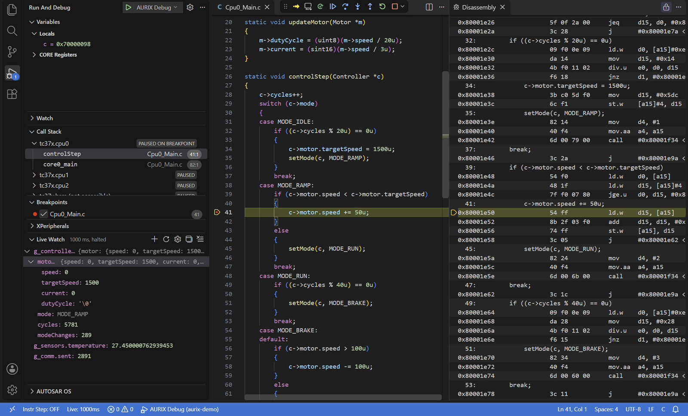
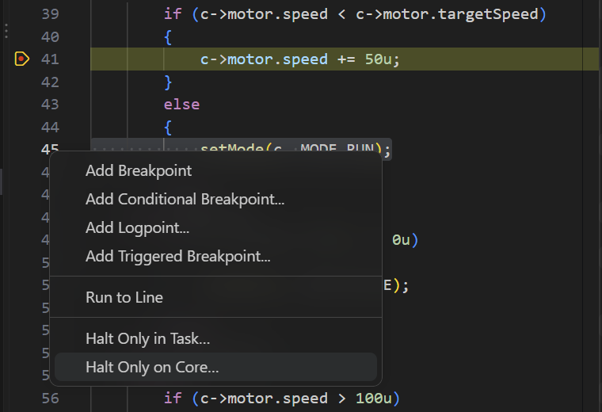
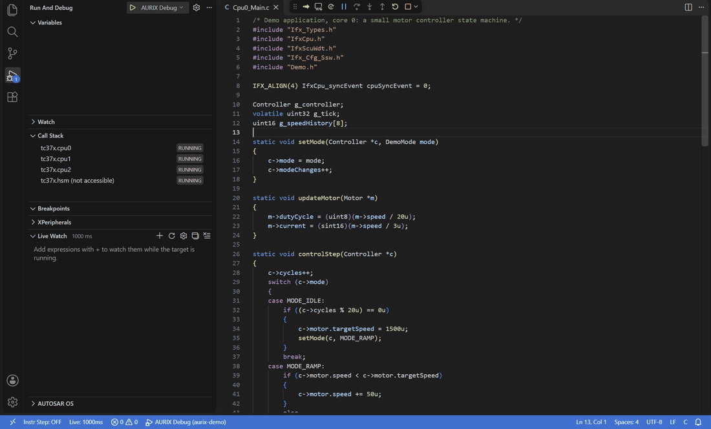
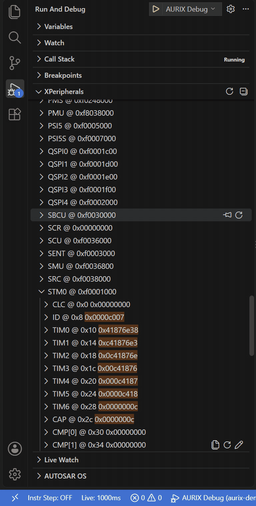
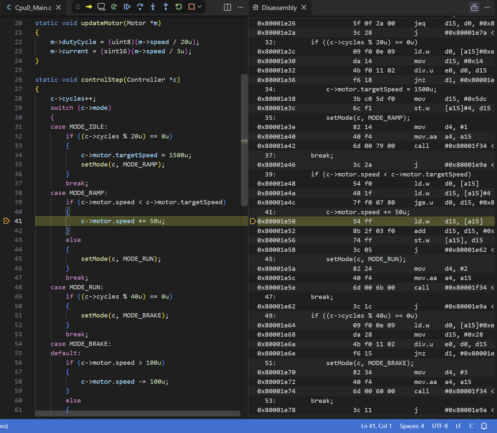
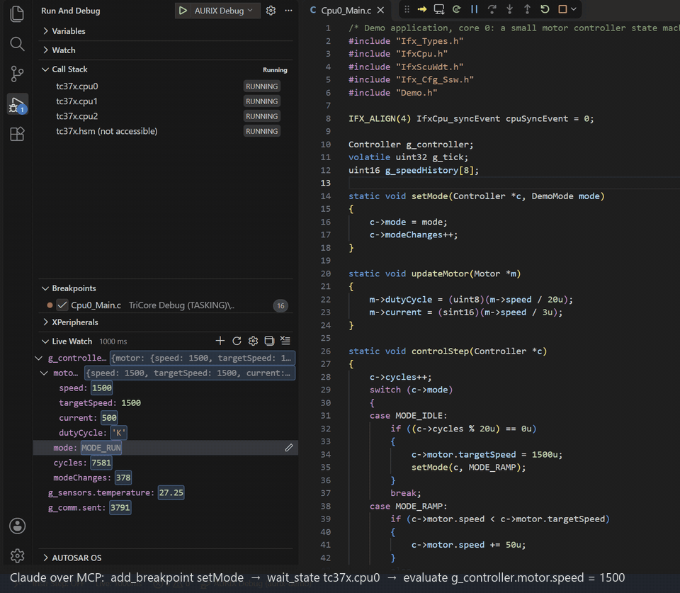

# AURIX&trade; Debugger for VS Code

> **Disclaimer:** This is a personal project, built and maintained by one developer in my own time. It is not an official Infineon product and has nothing to do with Infineon Technologies AG. It comes with no warranty and no promise of support or future updates. Use it at your own risk.

VS Code extension for debugging Infineon AURIX&trade; TC3xx devices: the TriCore cores, the HSM (Cortex-M3), the standby controller (SCR) and the GTM MCS channels. It talks to the board through an Infineon miniWiggler/DAP probe or an iSYSTEM BlueBox. The same debug session can be used by Claude and by scripts at the same time.



## Features

- **Run control:** multi-core debugging, step in/over/out, continue/pause, reset (running or halted at the reset vector), instruction stepping in the Disassembly view
- **Breakpoints:** line, function and instruction breakpoints, on chosen cores only (`@1`, `@hsm`), in a chosen AUTOSAR task or under a C condition (`count > 100`)
- **Data breakpoints:** break when a variable, an expression or an address is written, read or both
- **Watching data:** Call Stack and Variables, the Watch view, and a **Live Watch** that keeps updating while the target runs, in the sidebar or in editor tabs; C++ names are supported
- **Peripherals and memory:** read and write SVD registers in the Peripheral view (HSM and SCR peripherals included), the Memory Inspector, the Disassembly view with Go to Address or Symbol
- **AUTOSAR OS:** from the ORTI file: the running task per core, task names in the Call Stack, tasks, stacks and alarms, task profiling
- **On-chip trace (TC37x):** program flow and every write to a variable, recorded by the chip's miniMCDS over the miniWiggler
- **Flash and UCBs:** program ELF, HEX, S-record and binary images; read, compare, edit, export and write the TC3xx UCBs
- **Target health** in the status bar: no power, reset, no debug access, probe lost
- **Automation:** custom toolbar actions, `monitor` Tcl commands, and the debugger hub that serves VS Code, Claude (MCP), REST and Python

## Requirements

- Windows (x64) and VS Code 1.79 or newer
- A debug probe:
  - an Infineon miniWiggler or other DAP probe, with Infineon's `tas_server` (installed with Infineon DAS; started automatically when it isn't running), or
  - an iSYSTEM BlueBox (iC5700, iC5000). The extension talks to it over USB without winIDEA, but needs a winIDEA 9.21.417 installation for the probe's firmware files.
- A board configuration script for your board (see [Board setup](#board-setup))
- The Peripheral Inspector and Memory Inspector extensions (installed automatically)

## Installation

1. Get `aurix-debugger.vsix`: [build it](docs/building.md) or use one you were given.
2. In VS Code, open the Extensions view (`Ctrl+Shift+X`), click `...` and choose **Install from VSIX...**.
3. Reload the window.

The extension installs its debug server to `%LOCALAPPDATA%\aurix-dbg` and keeps it up to date; there is nothing else to install.

## Quick start

1. Copy `tc3xx_ocds.cfg`, `fs26_sbc.cfg` and the example board script `tc37x_ocds_init.cfg` from the [`aurix-debugger`](aurix-debugger) folder into your project, e.g. into `debug/`, and adapt the board script to your board (see [Board setup](#board-setup)).
2. Create `.vscode/launch.json`:

   ```json
   {
     "version": "0.2.0",
     "configurations": [
       {
         "type": "aurixdbg",
         "request": "launch",
         "name": "AURIX Debug",
         "searchDirs": ["${workspaceFolder}/debug"],
         "configFiles": ["board/infineon/kit_a2g_tc375_lite.cfg", "tc37x_ocds_init.cfg"],
         "symbolFiles": ["${workspaceFolder}/build/app.elf"],
         "flashFiles": ["${workspaceFolder}/build/app.hex"],
         "enableFlashing": true,
         "ortiFile": "${workspaceFolder}/build/Os_Trace.ORT",
         "device": "TC37x"
       }
     ]
   }
   ```

3. Press `F5`. The target is flashed, reset and runs; pause it with the toolbar.

## Launch configuration

| Attribute | Description |
|---|---|
| **Connection** | |
| `configFiles` | Configuration scripts, in order. The OpenOCD board scripts (`board/infineon/...`) are bundled. |
| `searchDirs` | Folders searched for the configuration scripts |
| `configCommands` | Tcl commands run after the scripts, e.g. `"set tc3xx_scr_target 1"` |
| `adapter` | Probe driver: `tas_client` (miniWiggler), `bluebox`, `winidea`; default: what the scripts select |
| `probe` | Serial number of the probe to use, when several are connected |
| `profile` | A session profile stored with the hub, used instead of the attributes above (which override its parts) |
| **Program** | |
| `symbolFiles` | ELF files with debug information: the application and, if needed, bootloader, HSM, SCR (`.cdb`) or MCS (`.asm`) files. A file applies to every core of its architecture; an entry `{ "path": ..., "cores": ["cpu0"] }` limits it. |
| `ortiFile` | The ORTI file of the AUTOSAR OS: enables the AUTOSAR OS view and task names |
| `sourceFileMap` | Maps path prefixes in the debug information onto local folders, e.g. `{ "c:/build/project": "${workspaceFolder}" }` |
| `sourceSearchPaths` | Folders searched for sources that are not found where the debug information says |
| `device` | Selects the SVD file of the Peripheral view and of the debug server's peripheral operations (REST/MCP `read_peripheral`, ...): `TC22x` … `TC39x`, `TC33xEXT`, `TC37xEXT`, `TC4Dx`. The debug server converts it (about 0.3 s for a TC3xx) |
| **Flash and reset** | |
| `flashFiles` | Images to program: ELF, Intel HEX, S-record or binary files ([details](docs/flashing-and-ucbs.md#flash-files)) |
| `enableFlashing` | Program `flashFiles` when the session starts (default `false`) |
| `verifyFlash` | Read the programmed sectors back (default `true`) |
| `resetType` | Reset used by the Reset button and after flashing (default `reset`) |
| `resetSuspend` | Halt at the reset vector after a reset (default `false`: run) |
| `runTo` | Run to a function, `file:line` or address after connecting |
| `stopOnEntry` | Pause after connecting |
| `ucbWrite` | Allow writing UCBs in this session (default `false`, see [UCBs](#ucbs)) |
| **Session** | |
| `session` | Attach to a session that is already open (e.g. one Claude opened) instead of opening one: no flashing, no reset |
| `sessionName` | Name of the session (default: the configuration name) |
| `sessionLifetime` | `close` (default): close the session when debugging ends; `keep`: leave it open, e.g. for Claude to go on |
| `hub`, `hubToken` | Use a debugger hub on another PC (see [Debugger hub](#debugger-hub-claude-and-scripts)) |
| **Views** | |
| `actions` | Custom toolbar actions (see [Debugger Actions](#debugger-actions)) |
| `liveWatchIntervalMs` | Refresh interval of the Live Watch in this session (minimum 200 ms) |
| `core` | Core to focus for memory access and instruction breakpoints |
| `enableConsoleLog` | Show the messages exchanged with the debug server in the Debug Console |

## Settings

| Setting | Default | Description |
|---|---|---|
| `aurix-debugger.liveWatch.intervalMs` | `1000` | How often the Live Watch and the AUTOSAR OS views refresh while the target runs (also set from the status bar) |
| `aurix-debugger.liveWatch.pauseWhileHalted` | `true` | Stop refreshing while all cores are halted. Turn off to watch peripherals that keep running. |
| `aurix-debugger.autoOpenDisassemblyView` | `true` | Open the Disassembly view when a session starts |
| `aurix-debugger.autoLockDisassemblyView` | `true` | Lock the Disassembly view's editor group |
| `aurix-debugger.autoEvenEditorWidths` | `true` | Size the editor groups evenly after opening the Disassembly view |
| `aurix-debugger.disassembly.opcodeBytes` | `left` | Opcode bytes `left` or `right` of the instruction, or `hidden` |
| `aurix-debugger.instructionSteppingDefault` | `false` | Start sessions in instruction stepping mode |
| `aurix-debugger.rememberDebugLayout` | `true` | Reopen the debug tabs where they were in the last session |
| `aurix-debugger.executePathMapper` | `true` | Run the `pathMapper` function of a launch configuration (trusted workspaces only) |
| `aurix-debugger.hub.url` | `http://127.0.0.1:3001` | The debugger hub to use |
| `aurix-debugger.hub.token` | | Token of a hub on another PC (default: the `AURIX_HUB_TOKEN` environment variable) |
| `aurix-debugger.hub.install` | `auto` | Keep the installed hub up to date (`off` to manage it yourself) |
| `aurix-debugger.hub.offerAttach` | `true` | Offer to attach when Claude or a script opens a session |

## Using the debugger

### Breakpoints

A breakpoint halts every core that reaches it. To halt only some cores, put them in the condition (`@1`, `@0,2`, `@hsm`, `@scr`) or after a function breakpoint's name (`Os_Task_10ms@1`). `task == ComTask` halts only in that AUTOSAR task. **Halt Only on Core…** and **Halt Only in Task…** on the line number's context menu set the same.



Any other condition is a C expression, evaluated on the halted core with its local variables, e.g. `g_motor.speed > 100 @1`. The core still halts on every hit and runs on when the condition is false, so a conditional breakpoint on a hot path slows the target down. Hit counts are not supported.

### Data breakpoints

Right-click a variable in the Variables, Watch or Live Watch view, or in the editor, and choose **Break on Value Change**, **Break on Value Read** or **Break on Value Access**. The core halts right after the access. Global variables are watched on every core; a condition such as `g_mode == 3 @1` narrows it down.


Each core has 8 hardware breakpoints, shared with the code breakpoints; a breakpoint that does not fit is shown unverified. More: [Data breakpoints](docs/data-breakpoints.md).

### Live Watch

The **Live Watch** view in the Run and Debug sidebar keeps reading variables and registers while the target runs. **Open Live Watch Panel...** opens more of them as editor tabs, each with its own list and refresh interval, e.g. on a second monitor.



- Add an expression with **+**: the list offers the global variables and their members, C++ ones by their qualified name (`app::g_motor.cfg.speed`).
- Double-click a value to change it, the name to edit the expression.
- `expr@1` reads the expression on core 1 (`@hsm`, `@scr`), e.g. for variables in core-local RAM.
- **Add to Live Watch** on a register in the Peripheral view adds the register.
- **Pause Updates** keeps an entry from being refreshed while the target runs.
- The refresh interval is set from the status bar or per view with its gear button. A view that is not visible reads nothing.
- **Trace every write** in a view's interval menu records its variables with the chip's trace instead of reading them: every change with target time, nothing missed between refreshes (TC37x, variables written by CPU0; see [On-chip trace](#on-chip-trace)). One view at a time can trace; an entry that cannot be traced is read as usual and its badge says why.

### AUTOSAR OS

With `ortiFile` set (or **Load ORTI File…**), the **AUTOSAR OS** view shows per core the running task, its priority, the running ISR and the last OS error, and the Call Stack names each core's thread after its running task. **Show AUTOSAR OS Objects** opens tables of tasks, stacks with their usage, alarms, resources and more. **Show OS Profile** samples which task runs on each core while the target runs; each lane (core, ISR) has its own rate, and CPU0's lanes can be traced instead of sampled, which catches every switch.

### On-chip trace

On a TC37x the debugger uses the chip's small trace unit (miniMCDS, 8 KB) over the ordinary miniWiggler connection. **Show Trace** opens the Trace panel:

- **Record** all code of CPU0, only inside one function or address range, or every write into a variable range.
- **Stop** when the core halts (the trace then ends exactly at the halt, e.g. a breakpoint), when the buffer is full, manually, or at a function.
- The panel checks the configuration as you type and shows the resources it takes; configurations can be saved by name, and a launch configuration `trace` object arms one when the session starts.
- **Arm on every run, stop on halt** arms the trace whenever you continue and reads it when the core halts, so every breakpoint comes with the trace up to it and Step Back works right away (`"trace": {"Auto": true}` in the launch configuration does the same).
- The result lists the executed code grouped by function with source lines and target times; a click opens the source. **Export CSV** saves it.
- **Instructions** shows every executed instruction with the source lines in between, what each instruction wrote, and the registers at any instruction, rebuilt from the state at the halt. Each value is exact, taken from memory at the halt, or unknown, and a click on a register tells where its value came from.
- **Step Back** and **Reverse Continue** in the debug toolbar replay the trace: the editor, Variables, Watch, Registers, Call Stack and Disassembly show the rebuilt state at that point, and Step, Step Into and Continue move forward again up to the halt.

8 KB holds about 80 µs of unfiltered program flow, more with a filter. Only CPU0 can be traced, and the data trace sees only CPU0's writes. A trace that stops on a halt runs right up to the breakpoint or halt point.

### Reverse debugging

With `"reverse": true` in the launch configuration (or **AURIX: Enable Reverse Debugging**), **Step Back** and **Reverse Continue** put the real core back into an earlier state: you step over a function, see a wrong result, step back to the call and step into it.

- Before every step, source step, run and register or memory write, the debugger saves the core's registers and its RAM (the ELF's writable sections, the stacks and the context save area). Step Back writes them back, so the core really stands there and runs from there again.
- Step Back goes to the start of the previous line (stepping backwards over calls), or by one instruction in instruction stepping mode. Inside a Continue it goes back by restoring the run's starting point and running again to that line; the trace of that run is compared with the first one, and a run that takes another path stops there and says so.
- Reverse Continue goes back to the last breakpoint or data breakpoint hit, or to the start of the history.
- Not rewound: peripherals (their writes are listed in the Debug Console), timers, the other cores, DMA. Going back a few steps inside the application works reliably; going back across initialisation is better done with a reset.
- An application that protects its RAM against other bus masters (TC3xx safety protection of the DSPR, `CPUx_SPR_SPROT`) also locks out the debugger: a Step Back that would have to write its stack or context save area is refused, and nothing is changed. When reverse debugging starts, the Debug Console lists which saved memory is closed to the debugger. A test build can open those areas to the debugger alone (master tags 28 and 30) with one more protection region per core while a debugger is connected.
- The mode records every action with the on-chip trace, so the Trace panel's own setup is off while it is on, and a launch configuration cannot have both `reverse` and `trace`. The panel's **History** tab lists the checkpoints and goes back to any of them; **Go here** in the Instructions tab goes back to an instruction of the last action.
- Without the mode, Step Back is the view-only trace replay above: the status bar shows **Trace replay · view only**, the current line is marked with where the core really is, and nothing on the target changes.

Options (`"reverse": {...}`): `history` (checkpoints kept, default 50, 0 for all since the last reset), `regions` and `exclude` (RAM added or left out, e.g. large buffers), `stackSymbols` / `csaSymbols` (when the linker symbols are not the iLLD or TASKING ones), `trace`, `maxHits`, `strict`. The Debug Console says at the start how much RAM is saved and how long one checkpoint takes.

### Peripheral view

The **XPeripherals** view shows the registers of the `device` set in the launch configuration, with their bit fields, and lets you change them. On TC3xx devices it also lists:

- the HSM's peripherals (`HSM_*`). The HSM-internal ones can only be read while the HSM firmware allows debugging.
- the SCR's registers (`SCR_*`), read while the SCR target is enabled and halted.

Registers that change when read (e.g. `TRNG_DATA32`) are not read automatically.



### Memory and disassembly

- **Memory Inspector:** run **Memory Inspector: Show Memory Inspector** and enter an address or expression while the target is paused.
- **Disassembly:** opens beside the source and follows the selected frame. The toolbar's **Enable Instruction Stepping** button makes the step buttons step instructions; instruction breakpoints are set like line breakpoints. The search icon in its title bar (`Ctrl+G`) shows any function, address or `symbol+offset`.



### Flashing and reset

With `enableFlashing`, `flashFiles` are programmed when the session starts; the **Flash Target** toolbar button programs them again during the session, e.g. after a rebuild. Afterwards, and with the **Reset** button, the target is reset with `resetType` and runs, or halts at the reset vector with `resetSuspend: true`. More: [Flashing and UCBs](docs/flashing-and-ucbs.md).

### UCBs

**AURIX: Show UCBs** reads the TC3xx user configuration blocks from the device and shows every field by name and meaning. It highlights what differs from the delivery state, where ORIG and COPY differ, and what takes effect only at the next reset.


- **Compare with HEX…** compares the device with the UCB records of an image, e.g. a post-build HEX, and takes over all, one UCB or single fields.
- **Export** writes a selection of UCBs to an Intel HEX file.
- Fields can be edited in place. Writing needs `"ucbWrite": true` in the launch configuration and your confirmation after the debug server's review: blocking problems and warnings first, and the device name typed for changes that can't be undone. A backup of all UCBs is saved first.

A wrong UCB can lock the device for good. More: [Flashing and UCBs](docs/flashing-and-ucbs.md#ucbs).

### Target health

When something is wrong with the connection, the status bar says so: **Target unpowered**, **Target reset** (while reconnecting), **No debug access**, **No device** or **Probe lost**; the tooltip has the details and the target voltage. A reset or a power cycle of the board is recovered without ending the session. When the probe is unplugged, the session ends with "Debug probe lost".


### Debugger Actions

`actions` in the launch configuration adds a **Debugger Actions** toolbar button with your own commands, e.g. to erase a flash bank or read a register. An action runs Tcl commands on the debug server or a command of this extension, optionally after a confirmation:

```json
"actions": [
  { "label": "Erase DFlash", "tcl": ["reset init", "flash erase_sector dfls0 0 last"], "confirm": "Erase the DFlash?", "resetAfter": true },
  { "label": "Show UCBs", "icon": "shield", "command": "aurix-debugger.showUcbs" }
]
```

More: [Debugger Actions](docs/debugger-actions.md).

### Debug Console

`monitor <command>` runs a Tcl command of the debug server, e.g. `monitor reset halt`. `monitor help` lists the commands, `monitor help <command>` describes one and `monitor help <word>` searches them. All commands are in the [Tcl command reference](aurix-debugger/server/docs/commands.md).

### Debug layout

When a session ends, the extension remembers where its tabs were (Disassembly, Live Watch panels, AUTOSAR OS panels, Memory Inspector) and reopens them there next time. **Reset Debug Layout** forgets it.

## Board setup

The configuration scripts tell the debugger which chip is on the board, which probe to use and how to reset the board.

- `tc3xx_ocds.cfg` describes the TC3xx chips; you don't change it.
- `tc37x_ocds_init.cfg` is an **example** board script for a TC37x board with a safety SBC (`fs26_sbc.cfg`). Start your own board script from it and keep only what your board needs.
- **BlueBox:** add `"adapter": "bluebox"` to the launch configuration. The winIDEA 9.21.417 installation is found in the usual install folders.
- **Password-protected devices:** `adapter debug_password -env <variable>` and `reset_config connect_assert_srst` in the board script; the password is taken from the environment variable and never logged.

More: [Board setup](docs/board-setup.md).

## Standby controller (SCR) and GTM MCS channels

Both are off by default. Turn them on in the launch configuration:

```json
"configCommands": ["set tc3xx_scr_target 1", "set tc3xx_mcs_modules {0 1}"]
```

- The SCR and each MCS channel show as threads of their own in the Call Stack, with disassembly, registers, stepping and breakpoints. Add the SCR's `.cdb` file or the MCS `.asm` sources to `symbolFiles` for source-level debugging.
- They are not halted together with the TriCores: the pause button and TriCore breakpoints leave them running, and their breakpoints stop only them.

More: [SCR and MCS channels](docs/scr-and-mcs.md).

## Debugger hub, Claude and scripts

The extension runs its debug server behind `aurix-hub`, a small background process (port 3001) that holds one session per board. VS Code, Claude and scripts can all use the same session: a breakpoint set by Claude shows up in VS Code, and a halt in VS Code is seen by Claude.



- **AURIX: Add Debugger MCP Server to Claude Config** sets up Claude Code to open sessions, flash, set breakpoints and read variables.
- **AURIX: Attach to Hub Session** attaches VS Code to a session that Claude or a script opened; the extension also offers this when one opens.
- **AURIX: Start Debugger Hub at Logon** keeps the hub running; **Show Debugger Hub Status** lists its sessions.
- **Another PC:** to use the probes of a lab PC, run `aurix-hub install --autostart --remote` there and set `aurix-debugger.hub.url` and `aurix-debugger.hub.token` here.

REST, MCP and Python: see the [server README](aurix-debugger/server/README.md#rest-mcp-and-python-api).

## Building from source

See [Building](docs/building.md).

## Acknowledgements

This work is based on [vscode-aurix-tcf-debugger](https://github.com/ZeZhan/vscode-aurix-tcf-debugger) by ZeZhan. Many thanks for creating it and making it available.

## License

The code in this repository, the extension and the `aurix-dbg` debug server, is released under the MIT License - see [`LICENSE`](LICENSE).

The Infineon SVD files and the OpenOCD scripts under `vscode-aurix-tcf-debugger/bin/`, and the third-party code built into `aurix-dbg.exe`, keep their own licenses - see [`THIRD_PARTY_NOTICES.md`](vscode-aurix-tcf-debugger/THIRD_PARTY_NOTICES.md).
