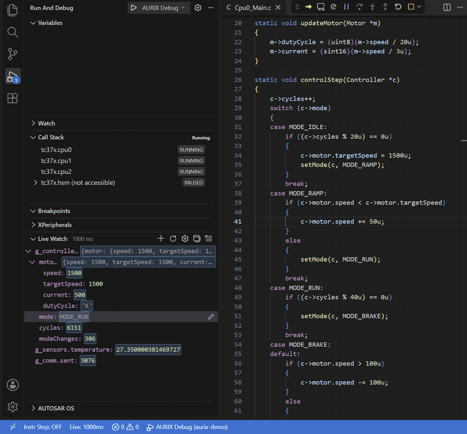
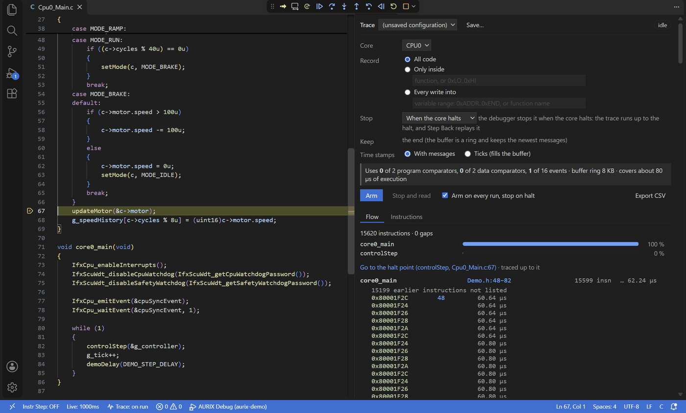
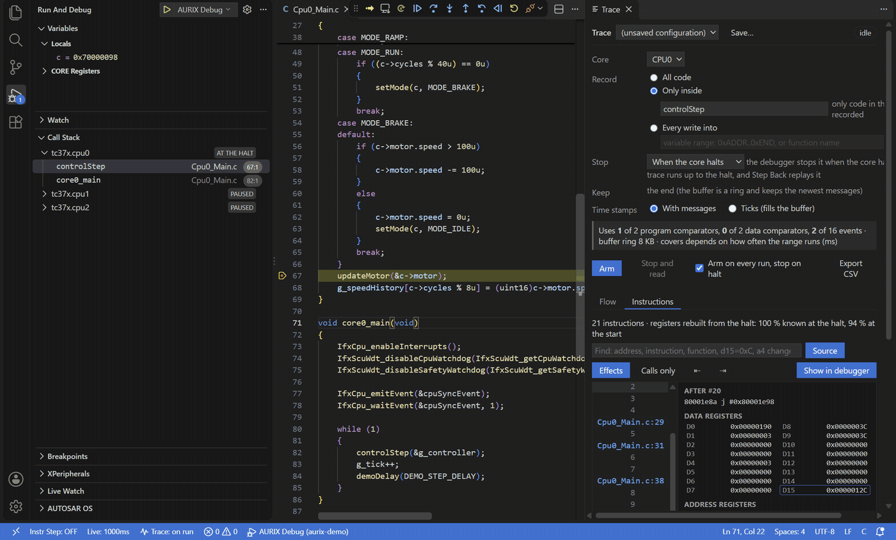
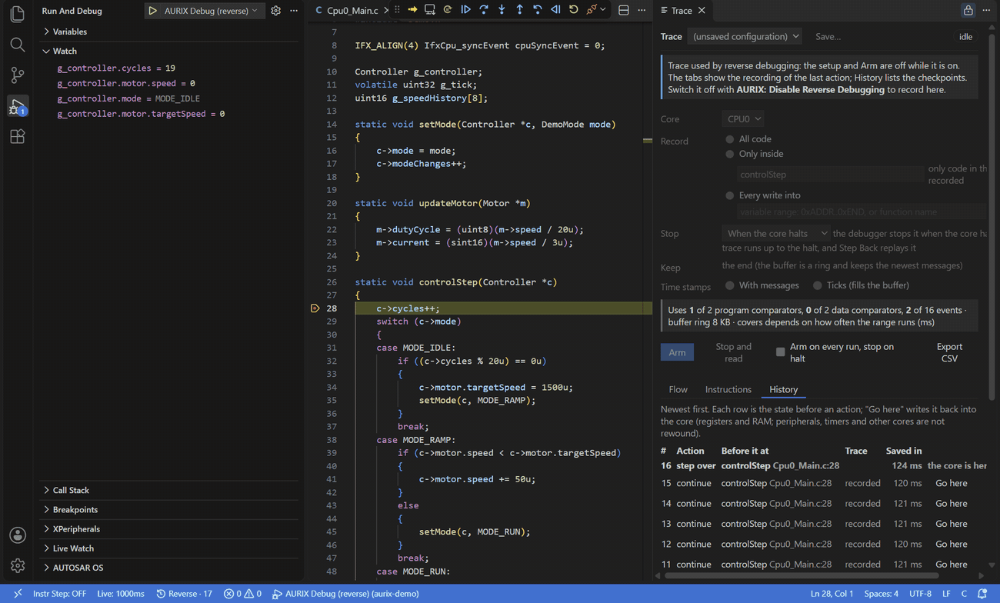
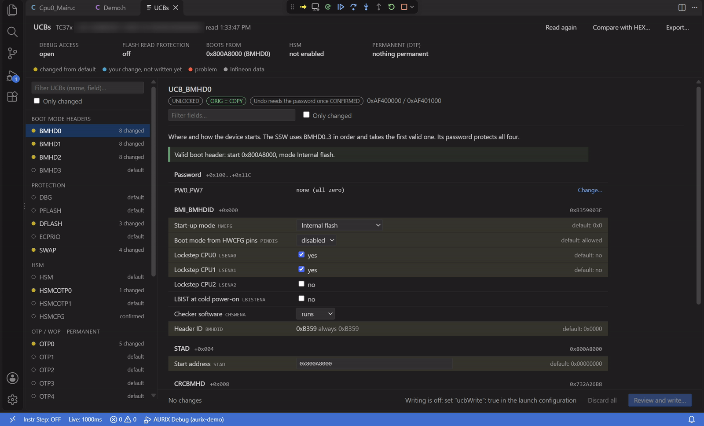
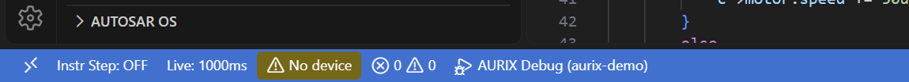
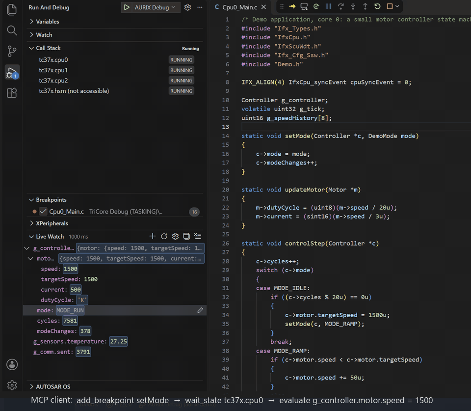

# AURIX&trade; Debugger for VS Code

> **Disclaimer:** A personal project, built and maintained by one developer in my own time. Not an official Infineon product and not affiliated with Infineon Technologies AG. No warranty, no promise of support or updates. Use it at your own risk.

VS Code extension for debugging Infineon AURIX&trade; TC3xx devices: the TriCore cores, the HSM (Cortex-M3), the standby controller (SCR) and the GTM MCS channels. Probes: Infineon miniWiggler/DAP or iSYSTEM BlueBox. AI assistants (MCP) and scripts can use the same debug session at the same time.


## Features

- **Run control:** multi-core, step in/over/out, continue/pause, reset (running or halted at the reset vector), instruction stepping in the Disassembly view
- **Breakpoints:** line, function and instruction; only on chosen cores (`@1`, `@hsm`), only in an AUTOSAR task, or under a C condition (`count > 100`)
- **Data breakpoints:** on write, read or both, for a variable, an expression or an address
- **Watching data:** Call Stack, Variables, Watch, and a **Live Watch** that updates while the target runs (sidebar or editor tabs); C++ names supported
- **Peripherals and memory:** SVD registers in the Peripheral view (HSM and SCR included), Memory Inspector, Disassembly view with Go to Address or Symbol
- **AUTOSAR OS (ORTI):** running task per core, task names in the Call Stack, tasks, stacks, alarms, task profiling
- **On-chip trace (TC37x):** program flow, every instruction with its registers, and every write to a variable, recorded by the miniMCDS over the miniWiggler; Step Back replays it
- **Reverse debugging:** Step Back and Reverse Continue restore the core's registers and RAM, and the code runs again from there
- **Flash and UCBs:** program ELF, HEX, S-record and binary images (only changed sectors); read, compare, edit, export and write the TC3xx UCBs
- **Target health** in the status bar: no power, reset, no debug access, probe lost
- **Automation:** custom toolbar actions, `monitor` Tcl commands, a debugger hub for VS Code, MCP clients, REST and Python

## Requirements

- Windows (x64), VS Code 1.79 or newer
- A debug probe:
  - Infineon miniWiggler or other DAP probe, with Infineon's `tas_server` (part of Infineon DAS; started automatically), or
  - iSYSTEM BlueBox (iC5700, iC5000). winIDEA itself is not used, but a winIDEA 9.21.417 installation must be present for the probe's firmware files.
- A board configuration script (see [Board setup](#board-setup))
- The Peripheral Inspector and Memory Inspector extensions (installed automatically)

## Installation

1. Get `aurix-debugger.vsix`: [build it](docs/building.md) or use one you were given.
2. In VS Code, open the Extensions view (`Ctrl+Shift+X`), click `...` and choose **Install from VSIX...**.
3. Reload the window.

The extension installs its debug server to `%LOCALAPPDATA%\aurix-dbg` and keeps it up to date.

## Quick start

1. Copy `tc3xx_ocds.cfg` and an example board script from the [`aurix-debugger`](aurix-debugger) folder into your project, e.g. into `debug/`, and adapt the board script (see [Board setup](#board-setup)):
   - `tc375_lite_example.cfg`: board without a safety SBC
   - `tc37x_fs26_example.cfg` (with `fs26_sbc.cfg`): board with an NXP FS26
2. Create `.vscode/launch.json`:

   ```json
   {
     "version": "0.2.0",
     "configurations": [
       {
         "type": "aurixdbg",
         "request": "launch",
         "name": "AURIX Debug",
         "searchDirs": ["${workspaceFolder}/debug"],
         "configFiles": ["board/infineon/kit_a2g_tc375_lite.cfg", "tc375_lite_example.cfg"],
         "symbolFiles": ["${workspaceFolder}/build/app.elf"],
         "flashFiles": ["${workspaceFolder}/build/app.hex"],
         "enableFlashing": true,
         "ortiFile": "${workspaceFolder}/build/Os_Trace.ORT",
         "device": "TC37x"
       }
     ]
   }
   ```

3. Press `F5`. The target is flashed, reset and runs. Pause it from the toolbar.

## Launch configuration

| Attribute | Description |
|---|---|
| **Connection** | |
| `configFiles` | Configuration scripts, in order. The OpenOCD board scripts (`board/infineon/...`) are bundled. |
| `searchDirs` | Folders searched for the configuration scripts |
| `configCommands` | Tcl commands run after the scripts, e.g. `"set tc3xx_scr_target 1"` |
| `adapter` | Probe driver: `tas_client` (miniWiggler), `bluebox`, `winidea`. Default: what the scripts select. |
| `probe` | Serial number of the probe, when several are connected |
| `profile` | Session profile stored with the hub; replaces the attributes above (set attributes override its parts) |
| **Program** | |
| `symbolFiles` | Files with debug information: the application ELF and, if needed, bootloader, HSM, SCR (`.cdb`) or MCS (`.asm`) files. A file applies to every core of its architecture; `{ "path": ..., "cores": ["cpu0"] }` limits it. |
| `ortiFile` | ORTI file of the AUTOSAR OS: enables the AUTOSAR OS view and task names |
| `sourceFileMap` | Maps path prefixes in the debug information onto local folders, e.g. `{ "c:/build/project": "${workspaceFolder}" }` |
| `sourceSearchPaths` | Folders searched for sources not found at their debug-information path |
| `device` | SVD file for the Peripheral view and the server's peripheral operations (REST/MCP `read_peripheral`, ...): `TC22x` … `TC39x`, `TC33xEXT`, `TC37xEXT`, `TC4Dx` |
| **Flash and reset** | |
| `flashFiles` | Images to program: ELF, Intel HEX, S-record or binary ([details](docs/flashing-and-ucbs.md#flash-files)) |
| `enableFlashing` | Program `flashFiles` when the session starts (default `false`) |
| `verifyFlash` | Read the programmed sectors back (default `true`) |
| `resetType` | Reset for the Reset and Flash Target buttons and after flashing (default `reset`; falls back to `reset` if the type fails) |
| `resetSuspend` | Halt at the reset vector after a reset (default `false`: run) |
| `runTo` | Run to a function, `file:line` or address after connecting |
| `stopOnEntry` | Pause after connecting |
| `ucbWrite` | Allow writing UCBs in this session (default `false`; see [UCBs](#ucbs)) |
| **Session** | |
| `session` | Attach to an open session (e.g. one an MCP client opened) instead of opening one. No flashing, no reset. |
| `sessionName` | Session name (default: the configuration name) |
| `sessionLifetime` | `close` (default): close the session when debugging ends. `keep`: leave it open, e.g. for an MCP client. |
| `hub`, `hubToken` | Use a debugger hub on another PC (see [Debugger hub](#debugger-hub-mcp-and-scripts)) |
| **Views** | |
| `actions` | Custom toolbar actions (see [Debugger Actions](#debugger-actions)) |
| `trace` | Arm an on-chip trace when the session starts (see [On-chip trace](#on-chip-trace)) |
| `reverse` | Reverse debugging (see [Reverse debugging](#reverse-debugging)) |
| `liveWatchIntervalMs` | Live Watch refresh interval in this session (minimum 200 ms) |
| `core` | Core to focus for memory access and instruction breakpoints |
| `enableConsoleLog` | Show the messages exchanged with the debug server in the Debug Console |

## Settings

| Setting | Default | Description |
|---|---|---|
| `aurix-debugger.liveWatch.intervalMs` | `1000` | Refresh interval of the Live Watch and AUTOSAR OS views while the target runs (also set from the status bar) |
| `aurix-debugger.liveWatch.pauseWhileHalted` | `true` | Stop refreshing while all cores are halted. Turn off to watch peripherals that keep running. |
| `aurix-debugger.autoOpenDisassemblyView` | `true` | Open the Disassembly view when a session starts |
| `aurix-debugger.autoLockDisassemblyView` | `true` | Lock the Disassembly view's editor group |
| `aurix-debugger.autoEvenEditorWidths` | `true` | Size the editor groups evenly after opening the Disassembly view |
| `aurix-debugger.disassembly.opcodeBytes` | `left` | Opcode bytes `left` or `right` of the instruction, or `hidden` |
| `aurix-debugger.instructionSteppingDefault` | `false` | Start sessions in instruction stepping mode |
| `aurix-debugger.rememberDebugLayout` | `true` | Reopen the debug tabs where they were in the last session |
| `aurix-debugger.executePathMapper` | `true` | Run the `pathMapper` function of a launch configuration (trusted workspaces only) |
| `aurix-debugger.hub.url` | `http://127.0.0.1:3001` | Debugger hub to use |
| `aurix-debugger.hub.token` | | Token of a hub on another PC (default: the `AURIX_HUB_TOKEN` environment variable) |
| `aurix-debugger.hub.install` | `auto` | Keep the installed hub up to date (`off`: manage it yourself) |
| `aurix-debugger.hub.offerAttach` | `true` | Offer to attach when an MCP client or a script opens a session |

## Using the debugger

Commands are in the Command Palette under **AURIX&trade; Debugger:**.

### Breakpoints

- A breakpoint halts every core that reaches it.
- Only some cores: put them in the condition (`@1`, `@0,2`, `@hsm`, `@scr`) or after a function breakpoint's name (`Os_Task_10ms@1`).
- Only in one AUTOSAR task: condition `task == ComTask`.
- **Halt Only on Core…** and **Halt Only in Task…** on the line number's context menu set the same.
- Any other condition is a C expression, evaluated on the halted core with its locals, e.g. `g_motor.speed > 100 @1`.
- The core halts on every hit and runs on when the condition is false: a conditional breakpoint on a hot path slows the target down.
- Hit counts are not supported.


### Data breakpoints

- Right-click a variable in the Variables, Watch or Live Watch view, or in the editor: **Break on Value Change**, **Break on Value Read** or **Break on Value Access**.
- The core halts right after the access.
- Globals are watched on every core; narrow it down with a condition such as `g_mode == 3 @1`.
- Each core has 8 hardware breakpoints, shared with code breakpoints. One that does not fit is shown unverified.



More: [Data breakpoints](docs/data-breakpoints.md).

### Live Watch

The **Live Watch** view (Run and Debug sidebar) reads variables and registers while the target runs. **Open Live Watch Panel...** opens more as editor tabs, each with its own list and interval.


- **+** adds an expression; the list offers globals and their members, C++ ones by qualified name (`app::g_motor.cfg.speed`).
- Double-click a value to change it, a name to edit the expression.
- `expr@1` reads on core 1 (`@hsm`, `@scr`), e.g. for core-local RAM.
- **Add to Live Watch** on a Peripheral view register adds the register.
- **Pause Updates** stops refreshing one entry.
- Refresh interval: from the status bar, or per view with its gear button. A hidden view reads nothing.
- **Trace every write** (a view's interval menu) records the view's variables with the on-chip trace instead of reading them: every change with target time (TC37x, writes by CPU0; see [On-chip trace](#on-chip-trace)). One view at a time; an entry that cannot be traced is read as usual and its badge says why.

### AUTOSAR OS

Set `ortiFile` or run **Load ORTI File…**. Then:

- The **AUTOSAR OS** view shows per core the running task, its priority, the running ISR and the last OS error.
- The Call Stack names each core's thread after its running task.
- **Show AUTOSAR OS Objects** opens tables of tasks, stacks with usage, alarms, resources and more.
- **Show OS Profile** samples which task runs on each core. Each lane (core, ISR) has its own rate; CPU0's lanes can be traced instead of sampled to catch every switch.

### On-chip trace

TC37x only, over the miniWiggler; no trace probe needed. **Show Trace** opens the Trace panel. It records CPU0's program flow (all code or one function) or every write into a variable range, and stops on halt, when full, manually or at a function.

- **Arm on every run, stop on halt:** every breakpoint comes with the trace up to it.
- Results: executed code by function with source lines and target times, and every instruction with the registers rebuilt from the halt.
- **Step Back** and **Reverse Continue** replay the trace: editor, Variables, Registers and Call Stack show the state at that point; the target is not changed.
- `"trace": { "Auto": true }` in the launch configuration arms it at start.





More: [On-chip trace and reverse debugging](docs/trace-and-reverse-debugging.md).

### Reverse debugging

`"reverse": true` in the launch configuration (or **Enable Reverse Debugging**) makes **Step Back** and **Reverse Continue** put the real core back into an earlier state: its registers and RAM are restored and it runs on from there.

- Step Back goes to the previous line, or one instruction in instruction stepping mode. Reverse Continue goes back to the last breakpoint hit.
- Not rewound: peripherals, timers, other cores, DMA.
- RAM protected against the debugger (TC3xx DSPR safety protection) cannot be restored; the Debug Console lists it at start.



More: [On-chip trace and reverse debugging](docs/trace-and-reverse-debugging.md#reverse-debugging).

### Peripheral view

The **XPeripherals** view shows the registers of the `device` set in the launch configuration, with bit fields, and lets you change them. On TC3xx it also lists:

- `HSM_*`: the HSM's peripherals. The HSM-internal ones are readable only while the HSM firmware allows debugging.
- `SCR_*`: the SCR's registers, readable while the SCR target is enabled and halted.

Registers that change when read (e.g. `TRNG_DATA32`) are not read automatically.


### Memory and disassembly

- **Memory Inspector:** run **Memory Inspector: Show Memory Inspector** and enter an address or expression while the target is paused.
- **Disassembly:** opens beside the source and follows the selected frame.
  - **Enable Instruction Stepping** (toolbar) makes the step buttons step instructions.
  - Instruction breakpoints are set like line breakpoints.
  - The search icon in the title bar (`Ctrl+G`) goes to a function, address or `symbol+offset`.


### Flashing and reset

- With `enableFlashing`, `flashFiles` are programmed when the session starts.
- Only sectors that differ are erased and programmed, through a loader in cpu0's RAM: a full 6 MB image takes well under half a minute.
- **Flash Target** (toolbar) programs them again, e.g. after a rebuild.
- After flashing and with **Reset**, the target is reset with `resetType` and runs, or halts at the reset vector with `resetSuspend: true`.

More: [Flashing and UCBs](docs/flashing-and-ucbs.md).

### UCBs

**Show UCBs** reads the TC3xx user configuration blocks and shows every field by name and meaning. Highlighted: differences from the delivery state, ORIG/COPY mismatches, and what takes effect only at the next reset.



- **Compare with HEX…** compares with the UCB records of an image (e.g. a post-build HEX) and takes over all, one UCB or single fields.
- **Export** writes selected UCBs to an Intel HEX file.
- Fields are edited in place. Writing needs `"ucbWrite": true` and your confirmation after the debug server's review (blocking problems and warnings; the device name typed for changes that can't be undone). All UCBs are backed up first.

A wrong UCB can lock the device for good. More: [Flashing and UCBs](docs/flashing-and-ucbs.md#ucbs).

### Target health

The status bar shows connection problems: **Target unpowered**, **Target reset** (while reconnecting), **No debug access**, **No device**, **Probe lost**. The tooltip has details and the target voltage.

- A board reset or power cycle is recovered without ending the session.
- An unplugged probe ends the session with "Debug probe lost".



### Debugger Actions

`actions` in the launch configuration adds a **Debugger Actions** toolbar button with your own commands: Tcl commands on the debug server or a command of this extension, optionally after a confirmation.

```json
"actions": [
  { "label": "Erase DFlash", "tcl": ["reset init", "flash erase_sector dfls0 0 last"], "confirm": "Erase the DFlash?", "resetAfter": true },
  { "label": "Show UCBs", "icon": "shield", "command": "aurix-debugger.showUcbs" }
]
```

More: [Debugger Actions](docs/debugger-actions.md).

### Debug Console

- `monitor <command>` runs a Tcl command of the debug server, e.g. `monitor reset halt`.
- `monitor help` lists the commands, `monitor help <command>` describes one, `monitor help <word>` searches.
- All commands: [Tcl command reference](aurix-debugger/server/docs/commands.md).

### Debug layout

When a session ends, the positions of its tabs (Disassembly, Live Watch panels, AUTOSAR OS panels, Memory Inspector) are saved and restored next time. **Reset Debug Layout** forgets them.

## Board setup

Configuration scripts tell the debugger the chip, the probe and how to reset the board.

- `tc3xx_ocds.cfg`: shared by every TC3xx board. Don't change it; your board script loads it.
- `tc375_lite_example.cfg` (no safety SBC) and `tc37x_fs26_example.cfg` (NXP FS26, policy in `fs26_sbc.cfg`): **examples**. Start your board script from one and keep only what your board needs.
- **Attach mode:** `"configCommands": ["attach_mode halt", "init"]` attaches and halts where the application is. Others: `passive`, `hot` (default), `reset_halt`, `reset_run`.
- **BlueBox:** `"adapter": "bluebox"`. The winIDEA 9.21.417 installation is found in the usual install folders.
- **Password-protected devices:** `adapter debug_password -env <variable>` and `reset_config connect_assert_srst` in the board script. The password is read from the environment variable and never logged.

More: [Board setup](docs/board-setup.md).

## Standby controller (SCR) and GTM MCS channels

Both are off by default. Turn them on in the launch configuration:

```json
"configCommands": ["set tc3xx_scr_target 1", "set tc3xx_mcs_modules {0 1}"]
```

- The SCR and each MCS channel are separate threads in the Call Stack, with disassembly, registers, stepping and breakpoints.
- Source-level debugging: add the SCR's `.cdb` file or the MCS `.asm` sources to `symbolFiles`.
- They don't halt with the TriCores: pause and TriCore breakpoints leave them running; their own breakpoints stop only them.

More: [SCR and MCS channels](docs/scr-and-mcs.md).

## Debugger hub, MCP and scripts

The debug server runs behind `aurix-hub`, a background process (port 3001) with one session per board. VS Code, MCP clients (AI assistants) and scripts share a session: a breakpoint set over MCP shows in VS Code, a halt in VS Code is seen by the MCP client.



- **Add Debugger MCP Server:** writes the workspace `.mcp.json`, so an MCP client can open sessions, flash, set breakpoints, and read variables, the call stack with locals, and peripheral registers by name.
- **Attach to Hub Session:** attaches VS Code to a session an MCP client or a script opened (also offered when one opens).
- **Start Debugger Hub at Logon** keeps the hub running; **Show Debugger Hub Status** lists its sessions.
- **Another PC:** to use a lab PC's probes, run `aurix-hub install --autostart --remote` there and set `aurix-debugger.hub.url` and `aurix-debugger.hub.token` here.

REST, MCP and Python: [server README](aurix-debugger/server/README.md#rest-mcp-and-python-api).

## Building from source

See [Building](docs/building.md).

## Acknowledgements

Based on [vscode-aurix-tcf-debugger](https://github.com/ZeZhan/vscode-aurix-tcf-debugger) by ZeZhan. Many thanks for creating it and making it available.

## License

The code in this repository, the extension and the `aurix-dbg` debug server, is released under the MIT License - see [`LICENSE`](LICENSE).

The Infineon SVD files and the OpenOCD scripts under `vscode-aurix-tcf-debugger/bin/`, and the third-party code built into `aurix-dbg.exe`, keep their own licenses - see [`THIRD_PARTY_NOTICES.md`](vscode-aurix-tcf-debugger/THIRD_PARTY_NOTICES.md).
