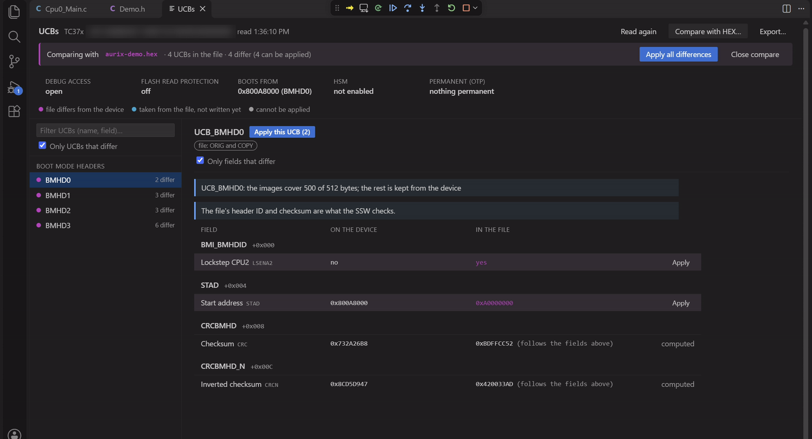

# Flashing and UCBs

## Flashing

With `"enableFlashing": true`, the images in `flashFiles` are programmed when the debug session starts. The **Flash Target** button on the debug toolbar programs them again during the session, e.g. after a rebuild. Afterwards the target is reset with `resetType` and runs, or halts at the reset vector with `"resetSuspend": true`.

### Flash files

`flashFiles` takes ELF, Intel HEX, S-record (`.srec`, `.s19`, `.s28`, `.s37`, `.mot`) and binary files. They are merged into one image first; where they overlap, later files win.

An entry is a path, or an object with `path`, `offset` and `type` (`elf`, `ihex`, `srec`, `bin`; detected from the file by default). `offset` is added to the file's addresses. A binary file has no addresses of its own and is placed at its `offset`:

```json
"flashFiles": [
  "${workspaceFolder}/build/app.hex",
  { "path": "${workspaceFolder}/build/cal.bin", "offset": "0x80300000" }
]
```

- Images other than ELF carry no debug information: list the ELF in `symbolFiles` as well. `symbolFiles` are never flashed.
- Use the post-build HEX if the build patches CRCs or fills gaps after linking.
- Image data outside the flash, e.g. initialized RAM in a post-build HEX, is skipped with a warning.
- `verifyFlash` (default `true`) reads the programmed sectors back and compares them with the image.
- UCB records in a HEX file are not programmed with the flash. With `ucbWrite`, they are reviewed after flashing and written only when you confirm them in the UCBs panel (see below).

### Reset

The **Reset** button resets the target with `resetType` (default `reset`): it runs afterwards, or halts at the reset vector with `resetSuspend`. **AURIX: Show Reset Capabilities** lists the reset types the debug server offers.

## UCBs

The user configuration blocks (UCBs) of a TC3xx hold the boot headers, flash protection, passwords, the debug lock and more. **AURIX: Show UCBs** opens a panel that reads all 48 UCBs from the device.

### Reading

- Every field is shown by name and meaning, e.g. a boot header's start address or a protected sector list.
- The panel highlights fields that differ from the delivery state, UCBs whose ORIG and COPY differ, and changes that the device installs only at the next reset.
- The UCB list and the field list have a text filter and **Only changed**.
- Passwords are shown masked; **Show** reads them.

Reading and exporting work without `ucbWrite`.

### Comparing with a HEX file



**Compare with HEX…** compares the device's UCBs with the UCB records of image files, e.g. the post-build HEX, field by field. You can take the file's values for everything, for one UCB or for single fields; they are then written like any other change. Read-only UCBs are shown but not applied, and passwords are compared without being shown.

### Exporting

**Export…** writes a selection of UCBs to an Intel HEX file: by name, confirmed or unconfirmed, by group, only changed ones, ORIG and/or COPY. The filters tick the matching UCBs, which you can then adjust one by one.

### Writing

Fields are edited in place; each change stays pending (with an undo) until written. Writing needs:

1. `"ucbWrite": true` in the launch configuration. It cannot be turned on from the Debug Console, by Claude or by a script.
2. Your confirmation after the debug server's review. The review lists blocking problems and warnings per UCB, for example:
   - a valid boot header must remain, and its start address must hold code
   - the HSM boot code must be present before HSM boot is enabled
   - the debugger must not lock itself out
   
   Changes that need the password to undo need a stronger confirmation; for changes that can never be undone, you type the device name.

Before writing, a backup of all UCBs is saved. COPY is written before ORIG, so a power loss during the write leaves a valid UCB.

> **Warning:** a wrong UCB can make the device unbootable or lock it for good. Read the review carefully.

Claude and scripts can read UCBs and run the review, but cannot confirm a write.
