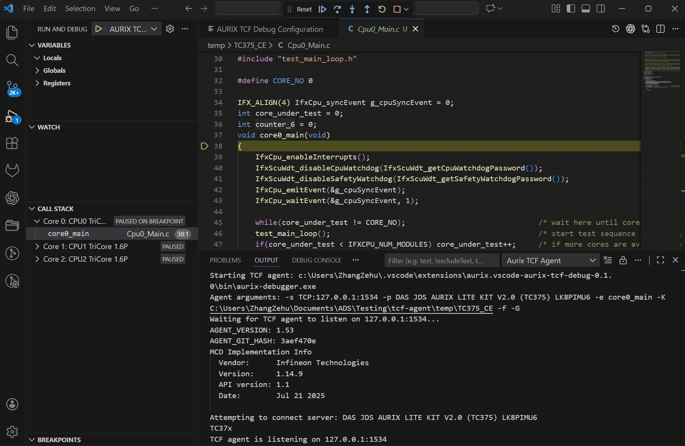
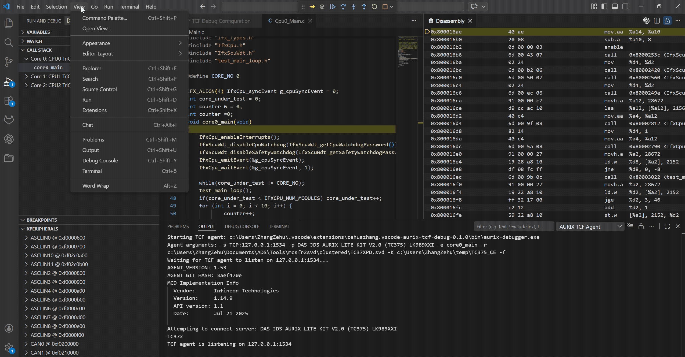
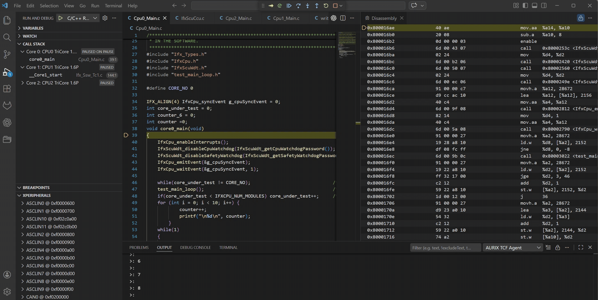

# AURIX&trade; Debugger for VS Code

> **Disclaimer:** This is a personal project, built and maintained by one developer in my own time. It is not an official Infineon product and has nothing to do with Infineon Technologies AG. It comes with no warranty and no promise of support or future updates. Use it at your own risk.

VS Code extension for debugging Infineon AURIX&trade; TC3xx devices: the TriCore cores, the HSM (Cortex-M3) and the GTM MCS channels.

The extension uses `aurix-dbg`, a debug server that reaches the target through Infineon's `tas_server` and runs the OpenOCD configuration scripts. Its source is in the [`aurix-debugger`](https://github.com/fabtrie/vscode-aurix-debugger/tree/main/aurix-debugger) folder of this repository. `aurix-dbg.exe` is bundled with the extension; the setting `aurix-debugger.agentPath` or the launch attribute `agentPath` point to a different build.

## Features

- Multi-core debugging of the TriCore cores, the HSM and the GTM MCS channels
- Line, function and instruction breakpoints, optionally only on chosen cores (`@1`, `@hsm`) or in a chosen AUTOSAR task
- Step in/out, step over, continue/pause, restart, terminate
- Call stack and variables, including frames without debug information
- Live Watch of variables and registers while the target runs, in the sidebar or in editor panels
- Peripheral view (read and write SVD registers), including the TC3xx HSM peripherals
- Memory Inspector (read and write memory)
- Disassembly view, instruction stepping mode, Go to Address or Symbol
- AUTOSAR OS awareness from the ORTI file: tasks, stacks, running task per core, task profiling
- Flashing through aurix-dbg (`enableFlashing`, Flash Target toolbar button)
- Reset, with or without halting at the reset vector
- Custom Tcl debugger actions and `monitor` commands in the Debug Console
- Source path mapping for ELF files built in another checkout
- The debug tab layout is remembered between sessions

## Requirements

- Windows (x64)
- Visual Studio Code 1.79.0 or higher
- Infineon `tas_server` (TAS) and a miniWiggler/DAP probe
- OpenOCD configuration scripts for the board. OpenOCD's own scripts (`board/`, `target/`, ...) are bundled; the TC3xx setup [`tc3xx_ocds.cfg`](https://github.com/fabtrie/vscode-aurix-debugger/blob/main/aurix-debugger/tc3xx_ocds.cfg) and a board file like [`tc37x_ocds_init.cfg`](https://github.com/fabtrie/vscode-aurix-debugger/blob/main/aurix-debugger/tc37x_ocds_init.cfg) come from the `aurix-debugger` folder
- Peripheral Inspector extension (installed automatically as a dependency)
- Memory Inspector extension (installed automatically as a dependency)

## Bundled files (`bin/`)

- `aurix-dbg.exe` — the debug server
- `openocd/` — OpenOCD's Tcl scripts, passed to the server as a search directory
- `svd/` — SVD files for the Peripheral view

`aurix-dbg.exe` and `openocd/` are not in the repository: `npm run copy-agent` (also run when packaging) copies them from the `aurix-debugger` build.

## Build

From the repository root, to build the server and package the extension with it:

```bash
npm install
npm run package
```

In this folder, `npm run package` only compiles the TypeScript sources, copies the static assets, `aurix-dbg.exe` and the OpenOCD scripts, and produces `aurix-debugger.vsix`. `aurix-dbg.exe` is taken from the environment variable `AURIX_DBG_EXE` if set, otherwise from `../aurix-debugger/server/target/release/` or `../aurix-debugger/server/target/debug/`. See the [server README](https://github.com/fabtrie/vscode-aurix-debugger/blob/main/aurix-debugger/server/README.md) for building the server.

## Installation

### Install from VSIX

1. Build the project (see above)
2. Open the Extensions view by selecting the Extensions icon in the Activity Bar, or use the (`Ctrl+Shift+X`) keyboard shortcut.
3. Click `...` and choose "Install from VSIX..."
4. Select the `.vsix` file
5. Open Command Palette and run `Developer: Reload Window`

## Usage

### Launch configuration

Create `.vscode/launch.json`:

```json
{
  "version": "0.2.0",
  "configurations": [
    {
      "type": "aurixdbg",
      "request": "launch",
      "name": "AURIX Debug",
      "autoStartAgent": true,
      "searchDirs": ["${workspaceFolder}/debug"],
      "configFiles": ["board/infineon/kit_a2g_tc377tx_3v3_trb.cfg", "tc37x_ocds_init.cfg"],
      "symbolFiles": ["${workspaceFolder}/build/app.elf"],
      "flashFiles": ["${workspaceFolder}/build/app.hex"],
      "ortiFile": "${workspaceFolder}/build/Os_Trace.ORT",
      "device": "TC37x"
    }
  ]
}
```

Here `debug/` holds `tc3xx_ocds.cfg` and `tc37x_ocds_init.cfg`, copied from the `aurix-debugger` folder and adjusted for the board.

- `searchDirs`, `configFiles`, `configCommands` are passed to aurix-dbg as `-s`, `-f`, `-c`; `additionalAgentOptions` is appended as-is. The bundled OpenOCD scripts are always searched, after `searchDirs`.
- `autoStartAgent` starts the bundled `aurix-dbg.exe` (or `agentPath`); without it, the extension connects to an aurix-dbg already listening on `host:port` (default `127.0.0.1:1534`).
- `symbolFiles` lists the ELF files with debug information: the application and, if needed, bootloader, HSM or other images. A file applies to all cores of its architecture unless it has a `cores` filter.
- `enableFlashing` programs `flashFiles` before the session; the Flash Target toolbar button uses the same list. `verifyFlash` (default true) reads the programmed sectors back.
- After flashing and with the Reset button, the target is reset with `resetType` (default `reset`). With `resetSuspend: true` it halts at the reset vector; otherwise it runs, and the toolbar buttons pause all cores afterwards.
- `ortiFile` enables the AUTOSAR OS view and task names in the Call Stack.
- `sourceFileMap` maps path prefixes in the debug information onto local folders, and `sourceSearchPaths` lists folders searched for sources that are not found, e.g. when a compiler cache supplied objects built in another checkout.
- `device` selects the SVD file bundled with the extension for the Peripheral view: `TC22x`, `TC23x`, `TC26x`, `TC27x`, `TC29x`, `TC33x`, `TC33xEXT`, `TC35x`, `TC36x`, `TC37x`, `TC37xEXT`, `TC38x`, `TC39x`, `TC4Dx`.

### Breakpoints on chosen cores

Without anything else, a breakpoint halts every core that reaches it. To halt only some cores, put them in the breakpoint's condition (`@1`, `@0,2`, `@hsm`, or with a task filter `task == ComTask @1`), or after a function breakpoint's name (`Os_Task_10ms@1`). **Halt Only on Core…** and **Halt Only in Task…** on the line number context menu set the same.

### Watch global variables

Variables and expressions can be watched in the Run and Debug view's **WATCH** section.



### Live Watch View

The Live Watch view periodically refreshes selected global variables. Use the view's Settings button to configure its refresh interval (the minimum enforced value is 200 ms), or choose **Use global interval** to follow the interval set in the status bar, which the AUTOSAR OS views also use.

Once configured, the active interval appears in the view header (highlighted in orange). Resume the target to run the cores and observe the selected global variables update automatically.

- Entries look like the WATCH section: `name: value` in the theme's debug colors, with changed values highlighted. Structs and arrays show a short preview (`{a: 1, b: 2, …}`) and can be expanded. Pointers can be expanded to show the value they point to.
- `expr@N` evaluates an expression on core N (`expr@hsm` on the HSM), e.g. for a variable in a core's local RAM.
- Double-click a value (or press Enter) to change it. Double-click the name (or press F2) to edit the expression, e.g. to fix a typo. The context menu also copies the value or the expression.
- Right-click a register or field in the **XPeripherals** view and choose **Add to Live Watch**. Registers show as hex and can be set. Fields show their bits and are read-only; change them in the XPeripherals view.
- **Pause Updates** on an entry moves it to the **Paused** group, which is not refreshed while the target runs. **Resume Updates** moves it back.
- Paused entries still update like the WATCH section: when the target stops and when you press Refresh.
- The WATCH section only evaluates while the target is stopped. Use the Live Watch view to follow values while the target runs.

#### Live Watch Panels

Debugging needs room, so a Live Watch can also be opened as an editor tab: click **Open Live Watch Panel...** in the Live Watch view's title bar (or run it from the Command Palette) and create a named panel. Open as many as you need; each has its own expressions and its own refresh interval, and the Live Watch in the sidebar stays as it is.

- A panel is an editor, so it can be dragged out of the window, or moved with **Move Live Watch Panel into New Window** from its title bar menu (VS Code 1.85 or newer), e.g. onto a second monitor.
- Closing a panel keeps its expressions. Reopen it by name from **Open Live Watch Panel...**, where saved panels can also be renamed or deleted. Panels open when VS Code closes are restored.
- A panel that is not on screen (a tab in the background) reads nothing from the target. Each visible Live Watch reads at its own rate, so the load on the target adds up.
- **Add to Live Watch** in the XPeripherals view asks which Live Watch to add to when panels are open.


### AUTOSAR OS

With `ortiFile` set (or after the **Load ORTI File…** command), the **AUTOSAR OS** view in the Run and Debug sidebar shows per core the running task, its priority, the running ISR, the last OS service and error, and each core's thread in the Call Stack is named after its running task. **Show AUTOSAR OS Objects** opens tables of the objects the ORTI file declares (tasks, stacks with their usage, alarms, resources, ...) in an editor tab. **Show OS Profile** samples which task runs on each core while the target runs; task switches shorter than the sampling period are missed. The views refresh at the global interval set in the status bar; **Pause AUTOSAR OS Updates** stops that.

### Peripheral View

This Peripheral View depends on the extension `mcu-debug.peripheral-viewer`. The register definitions come from the SVD file bundled for the `device` set in the launch configuration.

For the TC3xx devices the view also shows the HSM, as the `HSM_*` peripherals merged in from `bin/svd/HSM_TC3xx.svd.gz`:

- `HSM_BRIDGE` holds the host-side bridge registers. They are always readable.
- The HSM-internal peripherals are AES, hash, PKC, timers, watchdog, TRNG, cache and the Cortex-M3 SCB, NVIC, SysTick, MPU, DWT and FPB. The server reads them through the HSM debug window. That only works while the HSM firmware has enabled HSM debugging (`DBGCTRL.HSM`) and the HSM target is configured. Otherwise they show a read error.
- Registers with destructive reads are not read automatically: `TRNG_DATA32` and `HASH_VAL`.
- Only expand `HSM_PKC_SCM` while `PKC_STATUS.BUSY` is 0.
- The run-control and breakpoint registers (DHCSR, FPB and DWT comparators, DBGBASE) are read-only here because the debug server owns them.

The SVD file is generated from `scripts/hsm-svd/hsm_tc3xx.json` with `npm run svd:hsm`. That also writes a readable copy, `scripts/hsm-svd/HSM_TC3xx.svd`, which works as a standalone Cortex-M3 SVD for the HSM. The standalone copy also contains `HSM_BRIDGE_HSMSIDE`, the bridge registers only the HSM can access (DBGCTRL, ERRCTRL, ...). This peripheral is not merged into the view.


### Memory Inspector

The extension depends on `eclipse-cdt.memory-inspector`. Use the Command Palette and run
`Memory Inspector: Show Memory Inspector` to open the view, then enter an
address or expression once the target is paused.



### Disassembly View & Instruction Stepping Mode

The disassembly view opens automatically side-by-side with the source code and stays synchronized with the currently selected frame. The toolbar includes an `Enable Instruction Stepping` button, which allows stepping through the program's disassembly instructions.


**Note:** If the `Enable Instruction Stepping` icon is grayed out, it indicates that instruction stepping is already enabled. To switch back to source code stepping, click the icon `Disable Instruction Stepping` again to disable instruction stepping.



Instruction breakpoints can be set in the same way as in the source code.

If the disassembly view is closed, use the Command Palette and run `Open Disassembly View` to open the view.

The setting `aurix-debugger.disassembly.opcodeBytes` places the opcode bytes of each instruction `left` (between address and instruction, default), `right` (after the instruction) or `hidden`. A change applies to instructions loaded after the next stop.

To show any other code location while the target is halted, click the search icon in the disassembly view's title bar (or press `Ctrl+G` in the view) and pick a function or enter an address (`0x80001234`) or `symbol+offset`. VS Code's disassembly view can only follow the selected stack frame, so the target appears as a `[Disassembly] ...` frame at the bottom of the call stack; it disappears when the target resumes.

### Debug layout

When a session ends, the extension remembers where its tabs were (Disassembly, Live Watch panels, AUTOSAR OS panels, Memory Inspector) and reopens them there in the next session. The setting `aurix-debugger.rememberDebugLayout` turns this off, and **Reset Debug Layout** forgets the saved layout.

### Debugger Actions

The launch configuration can define custom Tcl commands in `actions`. They are offered by the `Debugger Actions` toolbar button, which only appears when `actions` is set. An entry with `items` opens a submenu, an entry with `tcl` runs its command(s) in order on the debug server. The output is written to the Debug Console.

```jsonc
"actions": [
  {
    "label": "Mass Erase",
    "icon": "trash",
    "items": [
      {
        "id": "erasePflash",
        "label": "Erase PFlash",
        "tcl": "<tcl command for pflash mass erase>",
        "confirm": "Erase the complete PFlash?",
        "resetAfter": true
      },
      {
        "id": "eraseDflash",
        "label": "Erase DFlash",
        "tcl": ["reset init", "flash erase_sector dfls0 0 last"],
        "confirm": "Erase the complete DFlash?",
        "resetAfter": true
      }
    ]
  },
  {
    "label": "Read Device ID",
    "icon": "info",
    "tcl": "<tcl command>",
    "showOutput": true
  }
]
```

| Property | Description |
|---|---|
| `label` | Name shown in the list (required) |
| `description`, `detail`, `icon` | Additional text and codicon name |
| `items` | Submenu entries (same format) |
| `tcl` | Tcl command or list of commands; stops at the first error |
| `confirm` | Confirmation text shown before running |
| `resetAfter` | Reset the target afterwards like the Reset button |
| `showOutput` | Show the Tcl output in a notification |
| `timeout` | Timeout per command in seconds (default 900) |
| `id` | Lets you run the action from a keybinding |

The action is responsible for the target state it needs (e.g. halting the cores first). To run an action from a keybinding:

```json
{ "key": "ctrl+alt+e", "command": "aurix-debugger.runAction", "args": { "id": "erasePflash" }, "when": "debugType == aurixdbg" }
```


## Acknowledgements

This work is based on [vscode-aurix-tcf-debugger](https://github.com/ZeZhan/vscode-aurix-tcf-debugger) by ZeZhan. Many thanks for creating it and making it available.


## License

The code in this repository, the extension and the `aurix-dbg` debug server, is released under the MIT License - see [`LICENSE`](LICENSE).

The Infineon SVD files and the OpenOCD scripts under `bin/`, and the third-party code built into `aurix-dbg.exe`, keep their own licenses - see [`THIRD_PARTY_NOTICES.md`](THIRD_PARTY_NOTICES.md).
