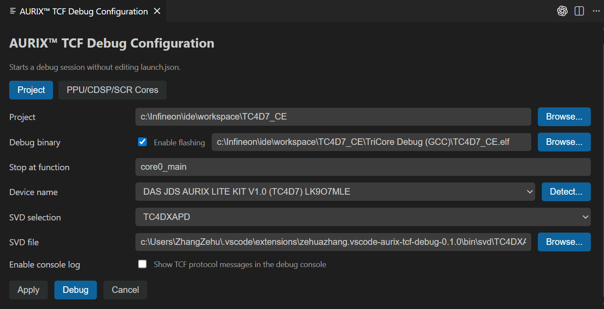
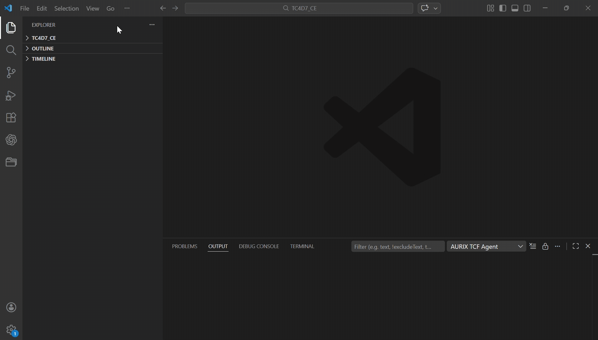

# AURIX&trade; TCF Debugger for VS Code

> **Disclaimer:** This is a personal project, built and maintained by one developer in my own time. It is not an official Infineon product and has nothing to do with Infineon Technologies AG. It comes with no warranty and no promise of support or future updates. Use it at your own risk.

This extension brings the TCF Debugger from [AURIX&trade; Configuration Studio](https://www.infineon.com/design-resources/platforms/aurix-software-tools/aurix-tools/aurix-configuration-studio) to VS Code. It talks to the same backend tools &mdash; the TCF agent and the AURIX&trade; Flasher &mdash; and only the VS Code frontend (the debug adapter, UI, and views) is rewritten here.

VS Code extension for debugging Infineon AURIX&trade; devices. It supports all AURIX&trade; TC2x, TC3x, and TC4x microcontrollers, including their TriCore, PPU, and CDSP cores.

## Features

- Multi-core debugging
- Line breakpoints and instruction/address breakpoints
- Step in/out, step over, continue/pause, restart, terminate
- Peripheral view (read and write SVD registers)
- Reset and halt at first breakpoint
- Call stack and variables
- Live watch of global variable
- Disassembly view
- Instruction stepping mode 
- Memory Inspector (read and write memeory)
- Launch configuration with AURIX&trade; device detect button
- Integrate AURIX&trade; Flasher
- Debug the PPU and CDSP cores

## Requirements

- Visual Studio Code 1.79.0 or higher
- DAS 8.3.0.1
- Peripheral Inspector extension (installed automatically as a dependency)
- Memory Inspector extension (installed automatically as a dependency)

## Backend binaries (`bin/`)

The backend tools live under `bin/` and are bundled with this repository:

- `aurix-debugger.exe` — the TCF agent
- `lsmcdd.exe`, `mcdxdas.dll` — DAS components
- `aurixflasher/` — the AURIX&trade; Flasher
- `svd/` — SVD files for the supported devices

These tools come from [AURIX&trade; Configuration Studio](https://www.infineon.com/design-resources/platforms/aurix-software-tools/aurix-tools/aurix-configuration-studio). Each one keeps its own license; see the files under `bin/aurixflasher/license/` for details.

## Build

```bash
npm install
npm run package
```

`npm run package` compiles the TypeScript sources, copies the static assets, and produces `vscode-aurix-tcf-debug.vsix` in the project root.

## Installation

### Install from VSIX

1. Build the project (see above) or download the `.vsix` from [Releases](https://github.com/ZeZhan/vscode-aurix-tcf-debugger/releases)
2. Open the Extensions view by selecting the Extensions icon in the Activity Bar, or use the (`Ctrl+Shift+X`) keyboard shortcut.
3. Click `...` and choose "Install from VSIX..."
4. Select the `.vsix` file
5. Open Command Palette and run `Developer: Reload Window`

## Usage

### Debug configuration (UI)

1. Open Command Palette and run `AURIX™ TCF: Open Debug Configuration`
2. Fill in the fields and save the configuration
3. Click `Debug` to start debugging



### Or create launch.json manually

Create `.vscode/launch.json`:

```json
{
  "version": "0.2.0",
  "configurations": [
    {
      "type": "aurix-tcf",
      "request": "launch",
      "name": "AURIX TCF Debug",
      "host": "127.0.0.1",
      "port": 1534,
      "autoStartAgent": true,
      "program": "${workspaceFolder}\\temp\\TC375_CE\\TriCore Debug (GCC)\\TC375_CE.elf",
      "targetDevice": "DAS JDS AURIX LITE KIT V2.0 (TC375) LK8PIMU6",
      "entryFunction": "core0_main",
      "svdFile": "",
      "workspace": "${workspaceFolder}\\temp\\TC375_CE",
    }
  ]
}
```

### Start debugging

We suggest start debugging with `AURIX™ TCF: Open Debug Configuration`



### Watch global variables

Variables and expressions can be watched in the Run and Debug view's **WATCH** section.


### Live Watch View

The Live Watch view periodically refreshes selected global variables. Use the view's Settings button to configure the refresh interval (the minimum enforced value is 200 ms).

Once configured, the active interval appears in the view header (highlighted in orange). Resume the target to run the cores and observe the selected global variables update automatically.


### Peripheral View

This Peripheral View depends on the extension `mcu-debug.peripheral-viewer`. A SVD file is needed to enable this view and to keep it in sync with the target.


### Memory Inspector

The extension depends on `eclipse-cdt.memory-inspector`. Use the Command Palette and run
`Memory Inspector: Show Memory Inspector` to open the view, then enter an
address or expression once the target is paused.


### Disassembly View & Instruction Stepping Mode

The disassembly view opens automatically side-by-side with the source code and stays synchronized with the currently selected frame. The toolbar includes an `Enable Instruction Stepping` button, which allows stepping through the program's disassembly instructions. 


**Note:** If the `Enable Instruction Stepping` icon is grayed out, it indicates that instruction stepping is already enabled. To switch back to source code stepping, click the icon `Disable Instruction Stepping` again to disable instruction stepping.


Instruction breakpoints can be set in the same way as in the source code.

If the disassembly view is closed, use the Command Palette and run `Open Disassembly View` to open the view

### PPU / CDSP Cores

In addition to the TriCore cores, the debugger supports the cores: **PPU** and **CDSP**. Open `AURIX™ TCF: Open Debug Configuration` and switch to the **PPU/CDSP/SCR Cores** tab to assign an ELF file to each core:

- **PPU** — a single ELF file
- **CDSP** — up to 12 ELF files (CDSP0 – CDSP11)

The assigned ELF files provide the debug symbols used for source-level debugging on the corresponding core.


#### Flash Hex option

Each of the PPU and CDSP sections has a **Flash Hex** checkbox. When checked, the HEX file located next to the configured ELF (same path and name, with the `.elf` extension replaced by `.hex`) is programmed into flash before the debug session starts:

- **PPU Flash Hex** — flashes the HEX next to the PPU ELF.
- **CDSP Flash Hex** — flashes the HEX next to every configured CDSP ELF.

### Debugger Actions

With `agentFlavor` `aurix-dbg`, the launch configuration can define custom Tcl commands in `actions`. They are offered by the `Debugger Actions` toolbar button, which only appears when `actions` is set. An entry with `items` opens a submenu, an entry with `tcl` runs its command(s) in order on the debug server. The output is written to the Debug Console.

```jsonc
"actions": [
  {
    "label": "Mass Erase",
    "icon": "trash",
    "items": [
      {
        "id": "erasePflash",
        "label": "Erase PFlash",
        "tcl": "<tcl command for pflash mass erase>",
        "confirm": "Erase the complete PFlash?",
        "resetAfter": true
      },
      {
        "id": "eraseDflash",
        "label": "Erase DFlash",
        "tcl": ["<tcl command 1>", "<tcl command 2>"],
        "confirm": "Erase the complete DFlash?"
      }
    ]
  },
  {
    "label": "Read Device ID",
    "icon": "info",
    "tcl": "<tcl command>",
    "showOutput": true
  }
]
```

| Property | Description |
|---|---|
| `label` | Name shown in the list (required) |
| `description`, `detail`, `icon` | Additional text and codicon name |
| `items` | Submenu entries (same format) |
| `tcl` | Tcl command or list of commands; stops at the first error |
| `confirm` | Confirmation text shown before running |
| `resetAfter` | Reset the target afterwards like the Reset button |
| `showOutput` | Show the Tcl output in a notification |
| `timeout` | Timeout per command in seconds (default 900) |
| `id` | Lets you run the action from a keybinding |

The action is responsible for the target state it needs (e.g. halting the cores first). To run an action from a keybinding:

```json
{ "key": "ctrl+alt+e", "command": "aurix-tcf.runAction", "args": { "id": "erasePflash" }, "when": "debugType == aurix-tcf" }
```


## License

The code in this repository is released under the MIT License - see [`LICENSE`](LICENSE).

The prebuilt tools under `bin/` are not covered by that license. They come from AURIX&trade; Configuration Studio and keep their own licenses - see [`THIRD_PARTY_NOTICES.md`](THIRD_PARTY_NOTICES.md).
